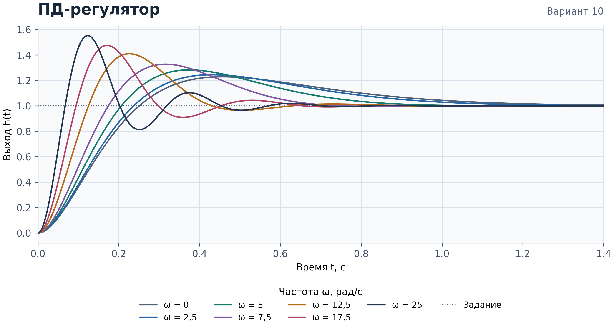
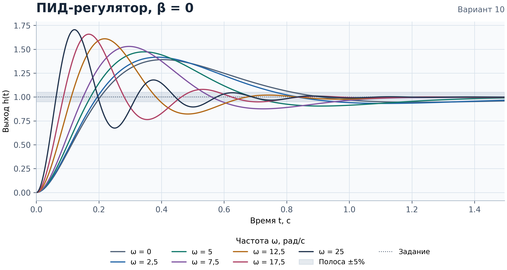
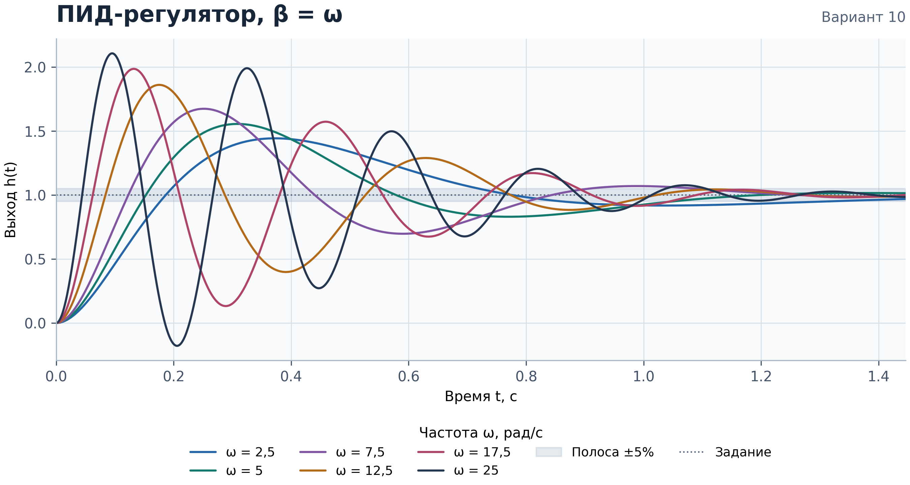

# Лабораторная работа № 5

**Синтез и анализ непрерывных систем управления максимальной степени устойчивости**  
Вариант 10

## Цель работы

Синтезировать ПД- и ПИД-регуляторы с максимальной степенью устойчивости замкнутой САУ и определить, как свободные параметры синтеза влияют на переходную характеристику при единичном скачке задания.

## Исходные данные

По таблице 5.1 методических указаний для варианта 10 коэффициенты объекта равны 0,25, 5, 1 и 0,1. После деления числителя и знаменателя на 0,25 получаем

$$
W_o(s)=\frac{1}{0{,}25s^3+5s^2+s+0{,}1}
      =\frac{4}{D(s)},\qquad D(s)=s^3+20s^2+4s+0{,}4.
$$

При единичной отрицательной обратной связи $E=R-Y$, а $Y=W_oW_p E$. Поэтому передаточная функция замкнутой системы по заданию равна

$$
T(s)=\frac{Y(s)}{R(s)}=\frac{W_o(s)W_p(s)}{1+W_o(s)W_p(s)}.
$$

Во всех трёх сериях $\omega=2{,}5k$ рад/с. Для ПД и ПИД с $\beta=0$ использованы $k=0,1,2,3,5,7,10$. Для ПИД с $\beta=\omega$ использованы $k=1,2,3,5,7,10$.

## Синтез по степени устойчивости

Устойчивая непрерывная САУ имеет полюса $s_i$ с $\operatorname{Re}s_i<0$. Степень устойчивости $\eta$ определяет скорость затухания наиболее медленной экспоненциальной составляющей, а степень колебательности $\mu$ характеризует соотношение частоты колебаний и затухания:

$$
\eta=-\max_i\operatorname{Re}s_i,\qquad
\mu=\max_i\left|\frac{\operatorname{Im}s_i}{\operatorname{Re}s_i}\right|.
$$

В обеих схемах нормированный характеристический полином имеет вид $s^n+20s^{n-1}+\ldots$. Число 20 возникает из отношения коэффициентов объекта $5/0{,}25$. ПД меняет коэффициенты при $s$ и $s^0$. У ПИД интегратор умножает знаменатель объекта на $s$, а регулятор меняет коэффициенты при $s^2$, $s$ и $s^0$. Поэтому в обеих схемах коэффициент при $s^{n-1}$ фиксирован.

По теореме Виета сумма корней равна $-20$. Максимальная действительная часть не меньше средней:

$$
\max_i\operatorname{Re}s_i\geq \frac{\sum_i\operatorname{Re}s_i}{n}
=-\frac{20}{n}
\quad\Longrightarrow\quad
\eta\leq\frac{20}{n}.
$$

Равенство достигается, когда действительные части всех корней равны $-20/n$. Мнимые части задаём сопряжёнными парами, чтобы коэффициенты полинома были вещественными. Затем раскрываем желаемый полином и приравниваем коэффициенты.

### ПД-регулятор

При $W_p=k_{\text{п}}+k_{\text{д}}s$ имеем

$$
T_{\text{ПД}}(s)=\frac{4(k_{\text{д}}s+k_{\text{п}})}
{s^3+20s^2+(4+4k_{\text{д}})s+0{,}4+4k_{\text{п}}}.
$$

При $n=3$ получаем $\eta=20/3$. Задаём корни $-\eta$ и $-\eta\pm j\omega$. Желаемый знаменатель равен

$$
(s+\eta)[(s+\eta)^2+\omega^2]
=s^3+3\eta s^2+(3\eta^2+\omega^2)s+\eta^3+\eta\omega^2.
$$

Отсюда

$$
k_{\text{д}}=\frac{3\eta^2+\omega^2-4}{4},\qquad
k_{\text{п}}=\frac{\eta^3+\eta\omega^2-0{,}4}{4}.
$$

Например, при $k=5$ получаем $\omega=12{,}5$, $k_{\text{п}}=334{,}391$, $k_{\text{д}}=71{,}396$. Корни равны $-6{,}667$ и $-6{,}667\pm j12{,}5$, поэтому $\mu=12{,}5/(20/3)=1{,}875$.

### ПИД-регулятор

При $W_p=k_{\text{п}}+k_{\text{д}}s+k_{\text{и}}/s$ обозначим $N(s)=4(k_{\text{д}}s^2+k_{\text{п}}s+k_{\text{и}})$. Тогда

$$
T_{\text{ПИД}}(s)=\frac{N(s)}{sD(s)+N(s)}.
$$

При $n=4$ имеем $\eta=5$. Желаемые корни равны $-5\pm j\omega$ и $-5\pm j\beta$. Раскрывая $[(s+\eta)^2+\omega^2][(s+\eta)^2+\beta^2]$ и приравнивая коэффициенты при $s^2$, $s$ и $s^0$, получаем

$$
\begin{aligned}
k_{\text{д}}&=\frac{6\eta^2+\omega^2+\beta^2-4}{4},\\
k_{\text{п}}&=\frac{4\eta^3+2\eta(\omega^2+\beta^2)-0{,}4}{4},\\
k_{\text{и}}&=\frac{(\eta^2+\omega^2)(\eta^2+\beta^2)}{4}.
\end{aligned}
$$

При $k=5$ и $\beta=0$ получаем $k_{\text{п}}=515{,}525$, $k_{\text{д}}=75{,}563$ и $k_{\text{и}}=1132{,}813$. Полюс $-5$ двойной, а $-5\pm j12{,}5$ простые. При $\beta=\omega=12{,}5$ получаем $906{,}150$, $114{,}625$ и $8212{,}891$ соответственно. Каждый полюс пары $-5\pm j12{,}5$ становится двойным.

## Методика измерения

Программа вычисляет переходную характеристику $h(t)=\mathcal L^{-1}\{T(s)/s\}$ для единичного скачка при нулевых начальных условиях. Для устойчивой системы теорема о конечном значении даёт $h_\infty=\lim_{s\to0}sT(s)/s=T(0)$. Для исследованных настроек варианта 10 $h_\infty>0$, поэтому показатели определяем по формулам

$$
e_\infty=1-h_\infty,\qquad
\sigma=100\%\cdot\frac{\max_{t\geq0}h(t)-h_\infty}{h_\infty},
$$

$$
t_{\text{р}}=\inf\{t\geq0\mid |h(\tau)-h_\infty|\leq0{,}05|h_\infty|
\text{ для всех }\tau\geq t\}.
$$

Код синтезирует полюса аналитически и проверяет их произведение по коэффициентам. Для расчёта отклика он переводит передаточную функцию в модель пространства состояний и численно интегрирует отклонение от равновесия. По этому решению уточняет максимум и последнее пересечение границы полосы. [Листинг программы](lab5.py)

## Результаты и их объяснение

Полная таблица по 20 опытам содержит настройки регуляторов, корни, $\eta$, $\mu$, установившийся выход и прямые показатели качества. [Таблица опытов CSV](results/experiments.csv)

### Установившаяся ошибка

Из исходной функции получаем $W_o(0)=1/0{,}1=10$. У ПД при $s=0$ дифференциальный член обращается в ноль. Поэтому

$$
e_{\infty,\text{ПД}}
=1-\frac{10k_{\text{п}}}{1+10k_{\text{п}}}
=\frac{0{,}1}{0{,}1+k_{\text{п}}}.
$$

При $k=0$ пропорциональный коэффициент равен $73{,}974$, ошибка — $0{,}001350$. При $k=10$ он вырос до $1115{,}641$, ошибка уменьшилась до $0{,}0000896$. Рост $k_{\text{п}}$ следует из положительного члена $\eta\omega^2/4$ в формуле синтеза ПД.

У ПИД $T(0)=4k_{\text{и}}/(4k_{\text{и}})=1$, поскольку при $s=0$ член $sD(s)$ обращается в ноль. Это объясняет $e_\infty=0$ во всех 13 опытах с ПИД.

### Перерегулирование и время регулирования

В ПД-серии при увеличении $\omega$ от 0 до 25 рад/с степень колебательности $\mu=\omega/\eta$ выросла от 0 до 3,75, а $\sigma$ — с 22,98% до 55,13%. У ПИД с $\beta=0$ перерегулирование выросло с 39,12% до 70,45%, а у ПИД с $\beta=\omega$ — с 44,22% до 110,57% при увеличении $\omega$ от 2,5 до 25 рад/с. Действительные части полюсов внутри каждой серии оставались постоянными.

При $\omega=12{,}5$ у обеих ПИД-систем $\eta=5$, $\mu=2{,}5$. При $\beta=0$ получены $\sigma=60{,}96\%$ и $t_{\text{р}}=0{,}6171$ с, а при $\beta=\omega$ — $85{,}96\%$ и $0{,}9714$ с. Двойная колебательная пара допускает составляющую $t e^{-5t}\sin(12{,}5t)$, а изменение коэффициентов регулятора меняет числитель $T(s)$ и тем самым вклады отдельных составляющих в отклик.

В ПД-серии при $\omega=7{,}5$, $12{,}5$ и $17{,}5$ измерено $t_{\text{р}}=0{,}6050$, $0{,}3959$ и $0{,}4128$ с соответственно. При одной и той же экспоненте $e^{-\eta t}$ изменение составляющих отклика сдвигает последнее пересечение границы полосы. Поэтому для выбора минимального $t_{\text{р}}$ сравнивались результаты всех опытов.

При $\omega=0$ ПД имеет тройной вещественный полюс и $\mu=0$, однако на графике остаётся одиночный выброс 22,98%. Составляющие вида $t^m e^{-\eta t}$ при вещественном кратном полюсе могут в сумме дать немонотонный отклик.

## Выводы

1. Все 20 настроек устойчивы. Достигнуты пределы $\eta_{\max}=20/3$ с⁻¹ для ПД и $\eta_{\max}=5$ с⁻¹ для ПИД, выведенные из коэффициента 20 при $s^{n-1}$.
2. Минимальное время регулирования среди проверенных настроек равно 0,3959 с для ПД при $k=5$, 0,5483 с для ПИД с $\beta=0$ при $k=10$ и 0,9714 с для ПИД с $\beta=\omega$ при $k=5$.
3. Интегральное звено ПИД устранило установившуюся ошибку на единичный скачок. Перерегулирование и время регулирования при фиксированных $\eta$ и $\mu$ зависят от полного набора полюсов и коэффициентов передаточной функции, что видно при сравнении двух ПИД-настроек с $k=5$.

Источник задания и исходных данных — [методические указания, с. 14–16](<../Методические указания по выполнению лабораторных работ (часть 1).pdf>).
